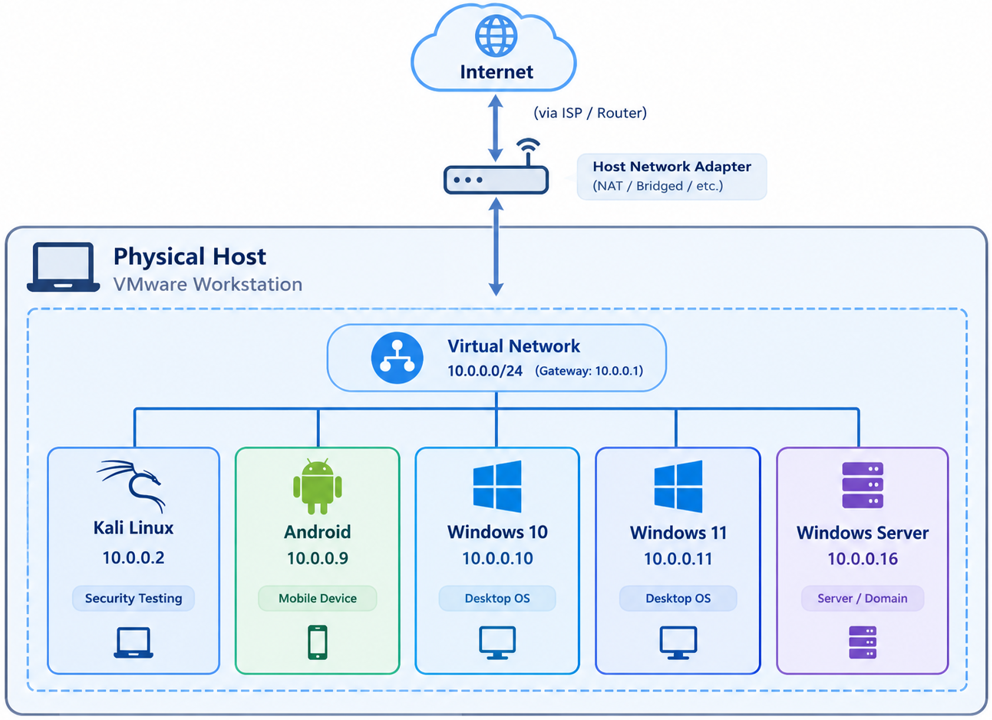

<h1 align="center">Home Lab Setup</h1>

  A controlled VMware home lab for practicing Windows, Linux, and Android security.

  
  

  
  
  

  <a href="VM/kali/README.md">Kali setup</a> ·
  <a href="VM/windows/README.md">Windows setup</a> ·
  <a href="VM/android/README.md">Android setup</a> ·
  <a href="Troubleshooting/README.md">Troubleshooting</a>

## Overview
A virtualized cybersecurity home lab running on VMware Workstation Pro. It integrates Kali Linux, Windows 10, Windows 11, Windows Server, and Android-x86 for penetration testing, Active Directory security testing, vulnerability assessment, and mobile security experimentation.

## Objectives

- Establish a virtualized environment for cybersecurity learning, testing, and experimentation.
- Practice Linux and Windows administration, networking, and cross-platform security testing.
- Configure NAT and Host-Only networking for controlled connectivity and isolation.
- Install and configure VMs to support current and future security labs without affecting the host operating system.
- Verify network communication between VMs where required.

## Architecture and Configuration
The lab runs on a Windows 11 host using VMware Workstation Pro. Each operating system runs as a separate virtual machine with its own allocated resources and virtual network configuration.

### Host Details

| Component | Specification |
|---|---|
| OS | Windows 11 x64 |
| RAM | 12 GB |
| Processor | Intel Core i5, dual-core |
| Hypervisor | VMware Workstation Pro |

### Virtual Machine Setup

| Virtual Machine | Role and Purpose | RAM | Storage | CPU | Setup Guide |
|---|---|---:|---:|---:|---|
| Kali Linux | Offensive security testing and vulnerability assessment | 4 GB | 80 GB | 2 cores | [Setup](VM/kali/README.md) |
| Windows 10 | Windows client and attack-path testing | 4 GB | 40 GB | 2 cores | [Setup](VM/windows/README.md) |
| Windows 11 | Windows security testing and hardening | 4 GB | 60 GB | 4 cores | [Setup](VM/windows/README.md) |
| Windows Server | Active Directory, server services, and domain security testing | 4 GB | 60 GB | 4 cores | [Setup](VM/windows/README.md) |
| Android-x86 | Mobile environment and application security testing | 2 GB | 10 GB | 2 cores | [Setup](VM/android/README.md) |

>**Note:** Storage values represent configured virtual disk capacities, not actual host disk usage. VM memory and CPU allocations are configurable and should be adjusted according to available host resources. Avoid running all VMs simultaneously if resource usage becomes excessive.

## Lab Setup

### 1. Install VMware

- Download and install [VMware Workstation Pro](https://www.vmware.com/products/desktop-hypervisor/workstation-and-fusion).
- Verify that hardware virtualization is enabled and VMware runs correctly.

### 2. Configure NAT Networking

- Launch VMware Workstation Pro.
- Navigate to **Edit >> Virtual Network Editor**.
- Click **Change Settings** to obtain administrator privileges.
- Select **VMnet8**, the default NAT network.
- Configure the network as follows:

| Setting | Value |
|---|---|
| Subnet IP | `10.0.0.0` |
| Subnet Mask | `255.255.255.0` |
| NAT Gateway | `10.0.0.1` |

### 3. Create and Configure Virtual Machines

Create each VM, install its operating system, and configure its CPU, memory, storage, and network adapters.

- [Kali Linux Setup](VM/kali/README.md)
- [Windows VM Setup](VM/windows/README.md)
- [Android-x86 Setup](VM/android/README.md)

>Allocate resources according to the workload and available host capacity. Start only the VMs needed for each lab exercise.

### 4. Validate the Lab

- Confirm that each VM boots successfully.
- Verify network connectivity where required.
- Check resource consumption on the host and guest systems.
- Confirm that NAT and Host-Only networks provide the intended connectivity and isolation before conducting security tests.

## Security Considerations

- **Shared Resources:** Disable shared folders and clipboard sharing by default. Enable them only when necessary.
- **Network Isolation:** Use Host-Only networking for isolated testing and NAT when internet access is required. Avoid Bridged networking.
- **Firewall:** Re-enable Windows Firewall after connectivity testing.
- **Snapshots:** Take VM snapshots before major configuration changes or potentially destructive tests.
- **Sensitive Data:** Do not store personal or sensitive information inside lab VMs.
- **Network Safety:** Verify network isolation before running tools that generate potentially disruptive traffic.

## Troubleshooting

See the [Troubleshooting](Troubleshooting/README.md) for documented issues, root causes, and solutions involving VM startup, Android-x86 routing, and Kali Linux NAT connectivity.

## Key Takeaways

- Reserve sufficient RAM and CPU resources for the host operating system.
- Monitor resource consumption before starting additional VMs.
- Adjust VM allocations according to the workload.
- Validate network connectivity and isolation before testing.
- Document troubleshooting steps and solutions for future reference.

## Future Improvements

- **Host Isolation:** Restrict VM-initiated access to the Windows host while preserving required management access.
- **VM Security Hardening:** Apply and test additional security-hardening measures on individual VMs.
- **Containerized vulnerable applications:** Use Docker to deploy vulnerable applications without creating a separate VM for each application.
- **Proxmox VE:** Consider migrating to Proxmox VE when dedicated hardware becomes available and centralized VM management is needed.
- **Cloud-hosted lab:** Explore a VPS-based lab for selected exercises that require remote access or additional resources, while accounting for cost and security requirements.

## Lab Safety

- Conduct security testing only on systems you own or have permission to test.
- Keep vulnerable services and applications within the intended lab environment.
- Verify network isolation before running potentially disruptive tests.
- Disable shared folders and clipboard sharing unless required.
- Take VM snapshots before major changes or risky experiments.
